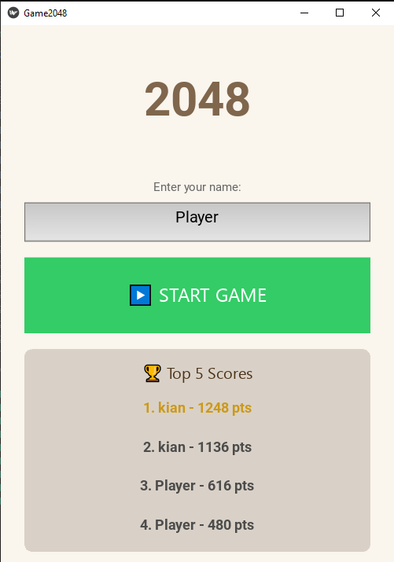
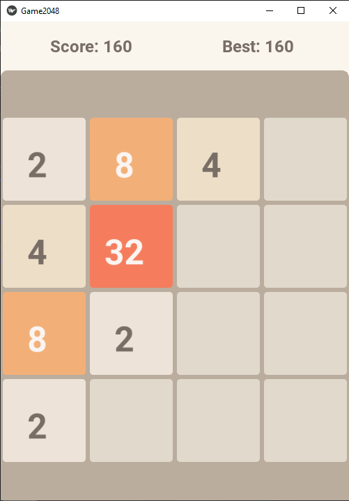
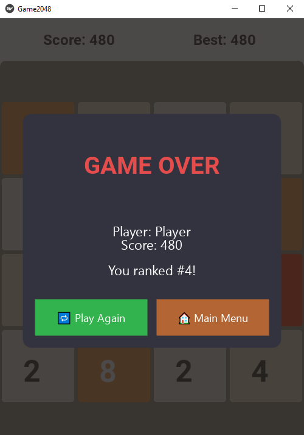

# 🎮 2048 (Pygame) - Kivy Edition

A complete, modern, and polished implementation of the classic **2048** puzzle game, built entirely with **Kivy** in Python. 

The game features a beautiful welcome screen where players can enter their name, a persistent Top 5 leaderboard, smooth keyboard and touch controls, and an elegant Game Over screen with rank calculation. Join the tiles, reach 2048, and claim the top spot on the scoreboard!

---

## 📖 About the Game

**2048** is a single-player sliding tile puzzle game created by Gabriele Cirulli in 2014. The objective is simple yet incredibly addictive: moved numbered tiles on a 4×4 board to sum them and create a tile with the number **2048**. 

The game is played on a 4x4 board. When two tiles have the same number on themselves, they **merge into one** and doubled the value. After every move, a new tile (either a 2 or a 4) randomly appears in an empty tile. The challenge is to manage the board carefully—if the board fills up and no more moves are possible, the game is over. It's a game of strategy, foresight, and spatial planning.

---

## 🎯 Game Rules in Detail

### The Board
- The board is a **4×4 grid** with 16 empty cells at the start.
- The game begins with **two randomly placed tiles** (either a `2` or a `4`).

### A Move
1. **Slide Tiles:** Use the Arrow Keys (or `W`, `A`, `S`, `D`) to slide all tiles on the board in one direction. You can also **Swipe** with your mouse or finger.
2. **Merging:** If two tiles of the **same number** collide while moving, they merge into a single tile with their combined value.
   - *Rule:* A single tile cannot be merged twice in the same move. (e.g., `2-2-2-2` becomes `4-4`, not `8`).
3. **New Tile:** After a valid move (a move that changes the board), a new tile (90% chance of being a `2`, 10% chance of being a `4`) appears in a random empty cell.
4. **Score:** When tiles merge, the new tile's value is added to your total score.

### Winning & Losing
- **Winning:** When you successfully create a tile with the number **2048**, you win the game!
- **Losing (Game Over):** The game ends when the board is completely full and there are no adjacent tiles with the same number (meaning no more moves are possible).

---

## 🧠 Strategy & Tips

Many players think 2048 is about luck, but high-scoring players use clear strategies:

### 1. The Corner Strategy (The Golden Rule)
Pick **one corner** (e.g., the bottom-right) and make it your goal to keep your highest-valued tile trapped in that corner for the entire game. Never move it out of the corner.

### 2. Keep the Board "Snake-like"
Arrange your tiles in a descending order, snaking along the edges. For example, keep your largest tile in the bottom-right, the next largest next to it, and so on. 

### 3. Do Not Slide Up and Down Randomly
If you are using the bottom row, **avoid pressing the Up arrow**. Pressing Up pulls tiles out of your bottom row, destroying your carefully built chain.

### 4. Merge Smaller Tiles First
Focus on merging `2`s into `4`s, `4`s into `8`s, etc. Clear out the smaller numbers while maintaining the big ones.

### 5. Think Two Steps Ahead
Before making a move, look at the board and ask: *"If I move Right, where will the new random tile likely appear, and can I still make a move next turn?"*

---

## ✨ Features

### Gameplay
- ✅ **Classic 2048 logic** perfectly implemented (handles double-merging rules correctly).
- ✅ **Smooth Controls:** Supports both Keyboard (Arrows/WASD) and Mouse/Touch Swipe gestures.
- ✅ **Game Over Detection:** Automatically detects when no more moves can be made.

### User Interface (Kivy UI)
- ✅ **Welcome Screen:** Enter your name and view the leaderboard before starting.
- ✅ **Persistent Scoreboard:** Top 5 scores are saved safely to `scores.json`.
- ✅ **Dynamic Game Over Modal:** A sleek popup showing your score, your name, and your rank (e.g., "NEW HIGH SCORE!" or "You ranked #3!").
- ✅ **Quick Restart:** Instantly start a new game from the Game Over popup without reloading.
- ✅ **High-Quality Text Rendering:** Numbers are perfectly centered and anti-aliased using Kivy's `CoreLabel`.
- ✅ **Emoji Support:** Integrated Windows Emoji fonts so icons like 🏆, 🔁, and 🏠 render perfectly in buttons and labels.

---

## 📋 Requirements

- **Python 3.8+**
- **Kivy** (UI Framework)

Install Kivy:
```bash
pip install kivy
```

---

## 📁 Project Structure

Your project folder should look like this:

```
project/
├── main.py
└── scores.json          ← created automatically to store the leaderboard
```

---

## 🚀 How to Run

1. Ensure `main.py` and the project folder are saved on your system.
2. Open a terminal in the project folder:
```bash
cd path/to/your/project
python main.py
```

---

## ⌨️ Controls

### On the Welcome Screen
| Action | Function |
|--------|----------|
| **Click Name Field** | Focus the input to type your name |
| **Click START GAME** | Begin the game |

### On the Game Screen
| Action | Function |
|--------|----------|
| **Arrow Keys / WASD** | Slide tiles Left, Right, Up, or Down |
| **Mouse Drag / Touch Swipe** | Slide tiles in the swiped direction |
| **`R` Key** | Instantly restart the current game |

### On the Game Over Screen
| Action | Function |
|--------|----------|
| **🔁 Play Again** | Restart the board immediately |
| **🏠 Main Menu** | Return to the Welcome Screen (Scoreboard is saved) |

---

## 🎨 Customization

You can easily change the game's look and feel by editing the top of `main.py`:

### Window Size
```python
Window.size = (500, 700)
```

### Tile Colors
Change the colors of the tiles as they reach higher numbers:
```python
TILE_COLORS = {
    0: (0.88, 0.85, 0.80, 1),   # Empty space
    2: (0.93, 0.89, 0.85, 1),   # Tile 2
    4: (0.93, 0.87, 0.78, 1),   # Tile 4
    ...
    2048: (0.93, 0.73, 0.17, 1) # Tile 2048 (Gold)
}
```

### Scoreboard Limit
To save more than just the Top 5 scores, change this line in the `save_score` function:
```python
scores = scores[:5]  # Change 5 to 10 if you want Top 10
```

---

## 🧠 How It Works (Technical)

### Grid & Merging Logic
The game uses a 2D list `grid = [[0]*4 for _ in range(4)]` to represent the board.
When a move happens, the code:
1. Extracts all non-zero tiles in the direction of movement.
2. Iterates through them and merges adjacent identical numbers (handling the "merge once" rule).
3. Re-pads the row/column with zeros.
4. If the grid changed, a new `2` or `4` is added to an empty cell.

### Screen Management
The app uses `ScreenManager` to switch between `WelcomeScreen` and `GameScreen`. 
When the player starts the game, their name is passed to the `Game2048` widget. 

### Score Persistence
Scores are handled using Python's built-in `json` module. When the game ends, the score is appended to `scores.json`, sorted by highest score, truncated to the top 5, and saved back to the file. The `WelcomeScreen` reads this file every time it is entered (`on_enter`) to display the most up-to-date leaderboard.

### Emoji Rendering Fix
Kivy's default font (Roboto) does not support colored emojis. To fix this on Windows, the code dynamically registers the Windows Emoji font (`seguiemj.ttf`) using `LabelBase.register()` and applies it to specific buttons and labels via `font_name='Emoji'`.

---

## 🗂️ Code Structure

```
main.py
├── Imports & Emoji Font Registration
├── Global Configurations (Colors, JSON path)
├── Score Persistence (load_scores, save_score)
├── GameOverPopup (ModalView for Game Over screen)
├── Game2048 (Widget containing grid logic, drawing, and input)
├── WelcomeScreen (Screen with Name Input and Leaderboard)
├── GameScreen (Wrapper for the Game2048 widget)
└── Game2048App (Main App managing ScreenManager)
```

---

## 🐛 Troubleshooting

### "I press a button and the game closes" or "Screen is Black"
- Ensure you added `os.environ['KIVY_GL_BACKEND'] = 'angle_sdl2'` at the very top of the file. This fixes graphic driver issues on most Windows PCs.

### Emojis show up as empty squares (□)
- This means Kivy couldn't find the Windows Emoji font. 
- Ensure the path `C:/Windows/Fonts/seguiemj.ttf` exists on your system. If you are on Mac/Linux, you need to change this path to your system's emoji font (e.g., `/System/Library/Fonts/Apple Color Emoji.ttc` for Mac).

### Scores are not saving
- Ensure the script has write permissions to the folder it is in.
- Check that `scores.json` is not open in another program.

---

## 📸 Screenshots

*(Replace these with your actual screenshots)*

### Welcome Screen & Leaderboard


### Gameplay (4x4)


### Game Over Popup


---

## 🧩 Ideas for Extension

- ⏪ **Undo Button:** Allow the player to undo their last move.
- 🎬 **Tile Animations:** Use Kivy `Animation` to make tiles smoothly slide across the board instead of teleporting.
- 🌙 **Dark Mode:** Add a toggle to switch the UI colors to a dark theme.
- 📱 **Mobile Support:** Package the game using `Buildozer` for Android/iOS.
- 🎵 **Sound Effects:** Add a "click" sound when tiles merge and a "game over" sound.

---

## 📄 License

This project is open-source and free to use, modify, and distribute for any purpose. 🎉